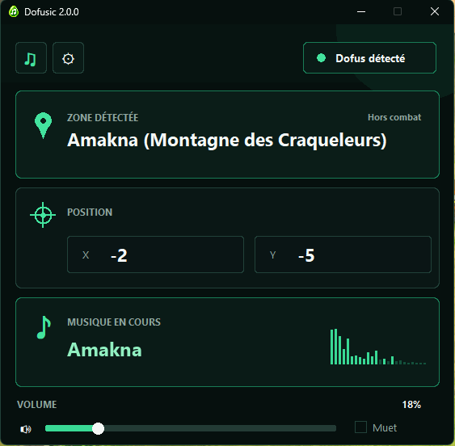
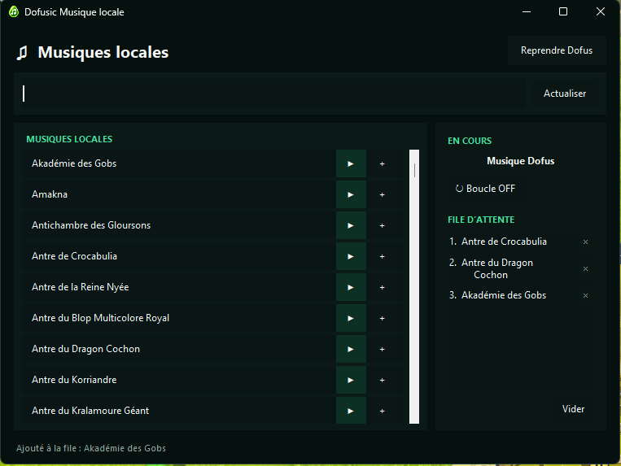
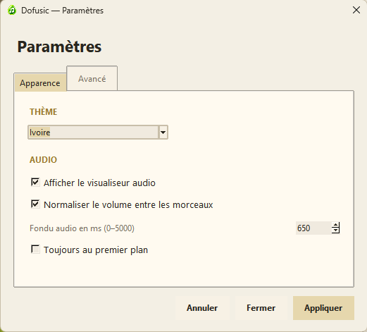

# Dofusic 2.0.0

**[Télécharger Dofusic — Windows 64 bits](https://github.com/Drentarra/Dofusic/releases/latest/download/Dofusic.zip)**

Dofusic adapte automatiquement la musique à la zone et aux combats de **Dofus**. Application portable, sans installation et sans compte.

**162 musiques OPUS incluses et préconfigurées**, avec de nombreux nouveaux morceaux pour les zones et donjons. Tout est prêt dans le ZIP.

## Aperçu

| Détection de la zone et musique en cours | Musiques locales et file d'attente |
| :---: | :---: |
|  |  |

Voir les paramètres et le thème clair

## Installation

1. Téléchargez et extrayez `Dofusic.zip`.
2. Lancez `Dofusic.exe`.
3. Désactivez la musique de Dofus et ouvrez le jeu en plein écran.

Dofusic détecte le jeu, suit votre zone et lance la musique correspondante. **Les musiques sont déjà fournies.**

Le ZIP de la release GitHub Actions contient `Dofusic.exe`, `Data/` et les 162 musiques du dossier `Musiques/`.

## Ajouter ou remplacer des musiques

Ouvrez le dossier `Musiques/` :

- **Ajouter :** nommez votre fichier comme la zone ou le donjon souhaité. Exemple : `Amakna.mp3` ou `Antre de Crocabulia.opus`.
- **Remplacer :** remplacez le fichier existant en conservant son nom. Si vous changez de format, retirez l'ancien fichier pour éviter les doublons.
- **Musiques génériques :** `Musique.opus`, `Musique1.opus`, etc. Pour les combats : `Musique Combat.opus`.

**OPUS est recommandé** pour sa taille réduite. **MP3 fonctionne aussi**, ainsi que OGG, FLAC, WAV, M4A, AAC et d'autres formats audio.

La fenêtre **Musiques locales** permet de rechercher des titres, de les écouter, de gérer la file d'attente ou de revenir à la lecture automatique.

## Informations

La reconnaissance des zones et combats se fait en local, sans envoi de captures ni télémétrie applicative.

[Code source et historique](CHANGELOG.md) · [Vie privée](Data/PRIVACY.md) · [Signaler un problème](https://github.com/Drentarra/Dofusic/issues) · [Sécurité](SECURITY.md) · [Licence MIT](LICENSE)

*Projet indépendant, sans affiliation avec Ankama.*
